<div align="center">

# AI Learning Coach

**可容器化部署的 AI 学习助理平台**  
个人知识库 · LangGraph 私教 · 混合 RAG · Java BFF + Python AI · 全链路可观测

[](LICENSE)
[](ai-service/)
[](java-app/)
[](web/)
[](docker-compose.yml)

[概览](#概览) · [核心能力](#核心能力) · [界面预览](#界面预览) · [快速开始](#快速开始) · [架构概览](#架构概览) · [文档](#文档)

<br/>

```bash
git clone https://github.com/stonebbmy/AI_Learning_Coach.git && cd AI_Learning_Coach
cp .env.example .env   # 填入 DEEPSEEK_API_KEY、SILICONFLOW_API_KEY
docker compose up --build -d
```

Web：<http://localhost:3000> · API（BFF）：<http://localhost:8080/swagger-ui.html>

</div>

> [!TIP]
> 过程级设计（中间件栈、Redis/Chroma 键空间、13 类防护、逐步数据流）见 **[`docs/ARCHITECTURE.md`](docs/ARCHITECTURE.md)**（约 800 行，与源码同步维护）。

---

## 目录

- [概览](#概览)
- [核心能力](#核心能力)
- [界面预览](#界面预览)
- [快速开始](#快速开始)
- [架构概览](#架构概览)
- [工程化设计](#工程化设计)
- [核心链路](#核心链路)
- [可观测与运维](#可观测与运维)
- [配置](#配置)
- [API 参考](#api-参考)
- [技术栈](#技术栈)
- [仓库结构](#仓库结构)
- [文档](#文档)
- [开发与贡献](#开发与贡献)
- [安全与许可](#安全与许可)

---

## 概览

**AI Learning Coach** 是 **Monorepo 全栈** 学习助理：Markdown 笔记入库 → 混合 RAG / LangGraph 私教 → 大纲与每日计划 → 进度持久化，支持 Docker 一键部署与生产向可观测。

| 维度 | 典型单页 Chat | 本项目 |
|------|---------------|--------|
| 入口 | 前端直连 LLM | **Nginx → Java BFF → ai-service**（SSE 专通道） |
| 知识 | 临时文件 | **Chroma** 去重分块；**BM25 + 向量 + Rerank** |
| 编排 | 单次 completion | **LangGraph**（私教、计划）+ **ReAct Agent** |
| 状态 | 内存或无 | **PostgreSQL** 业务数据 + **Redis** 会话与缓存 |
| 运维 | 无 | **Prometheus + Grafana**、熔断 / 限流 / Guardrails |

**依赖**：DeepSeek（对话）、OpenAI 兼容 Embedding（默认硅基流动 `BAAI/bge-m3`）、PostgreSQL、Redis、ChromaDB；可选 Langfuse。

---

## 核心能力

### 产品功能

| 路由 | 模块 | 说明 |
|------|------|------|
| `/` | 智能私教 | LangGraph 五段编排；七类意图；SSE + 结构化卡片 → [`tutor_orchestrator.py`](ai-service/app/agents/tutor_orchestrator.py) |
| `/home` | 功能导航 | 各学习模块入口 |
| `/knowledge` | 知识库 | `.md` 上传，按 `source` 先删后写，分块写入 Chroma |
| `/chat` | RAG 问答 | Guardrails → 双层缓存 → 混合检索 → Rerank → SSE |
| `/outline` | 学习大纲 | 生成 → 用户 confirm → JPA 入库 |
| `/plan` | 每日计划 | LangGraph + MCP；Java 缓存 / `DailyPlan` 持久化 |
| `/agent` | ReAct Agent | 本地工具 + ReAct 图，整链超时 |
| `/progress` | 学习进度 | 汇总已确认大纲与计划进度 |
| `/metrics` | 应用监控 | 缓存、Token、熔断、就绪探针 |
| `/eval` | RAG 评估 | LLM-as-Judge 三维评分（**离线抽检**） |
| `/grafana` | Grafana | 嵌入 Prometheus 预置盘 |

### 平台与工程

| 主题 | 做法 |
|------|------|
| 分层 | Java：BFF、事务、持久化；Python：模型、RAG、Graph、MCP（**AI 层可独立发版**） |
| 流式 | **WebClient** 代理 SSE；**OpenFeign** 负责 JSON + `@CircuitBreaker` |
| 韧性 | Python：超时、指数退避、LLM 熔断；Java：**Resilience4j** 滑动窗口 |
| 成本 | Redis 精确缓存 + Chroma 语义缓存；可选 Session Token 预算 |
| 可观测 | `X-Request-ID`、JSON 指标、Prometheus、Grafana |

---

## 界面预览

资源目录：[`docs/images/`](docs/images/)（建议源图 ≥1200px；下文预览宽度 1200）。

**索引导览**（正文按三节排列，节标题下为对应截图）：

| 图号 | 页面 | 路由 |
|:----:|------|------|
| 0–3 | 智能私教 | `/` |
| 4 | 功能导航 | `/home` |
| 5 | 知识库 | `/knowledge` |
| 6 | RAG 问答 | `/chat` |
| 7 | 学习大纲 | `/outline` |
| 8 | 每日计划 | `/plan` |
| 9 | 应用监控 | `/metrics` |
| 10 | RAG 评估 | `/eval` |
| 11 | Grafana | `/grafana` |
| 12 | API / 部署 | 见下文「工程与契约」 |

### 学习与对话

用户主路径：笔记入库 → 私教 / RAG → 大纲确认 → 今日计划。

#### 图 0 · 智能私教 · `/`

<p align="center">
  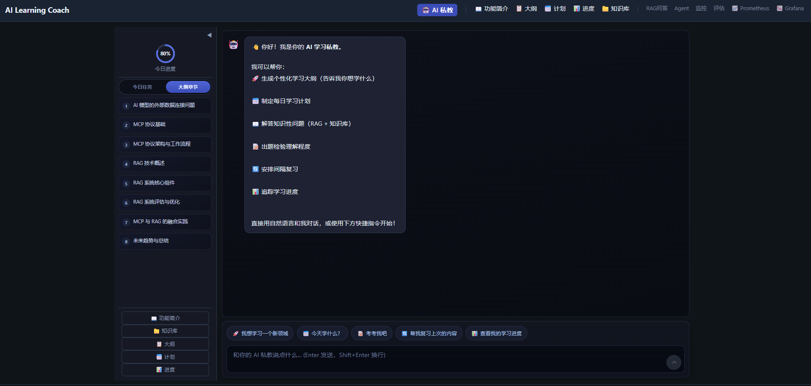
</p>

> 默认首页：LangGraph 多轮对话与结构化学习卡片。

#### 图 1 · 私教 · 入学与目标 · `/`

<p align="center">
  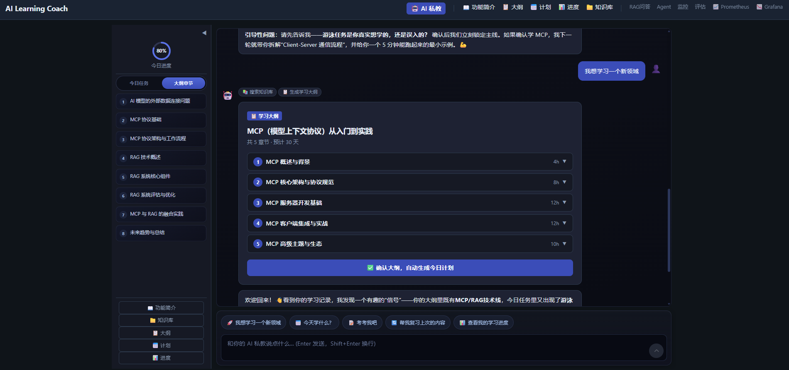
</p>

> ONBOARD：入学引导、学习目标设定。

#### 图 2 · 私教 · 计划 / 复习 / 测验 · `/`

<p align="center">
  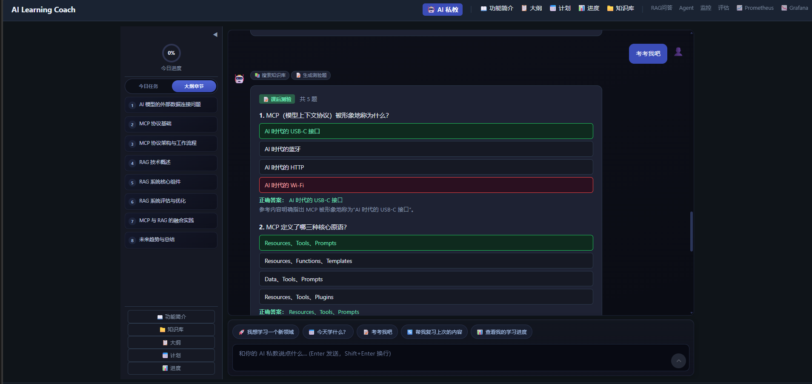
</p>

> 计划、复习、测验等意图下的卡片式反馈。

#### 图 3 · 私教 · 探索与测验 · `/`

<p align="center">
  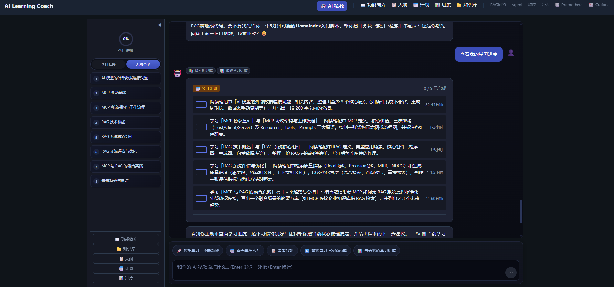
</p>

> 探索延伸、随堂测验等交互。

#### 图 4 · 功能导航 · `/home`

<p align="center">
  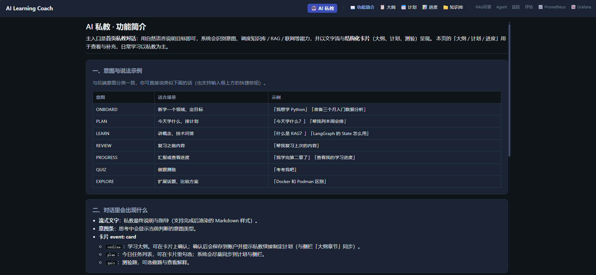
</p>

> 各学习模块入口一览。

#### 图 5 · 知识库 · `/knowledge`

<p align="center">
  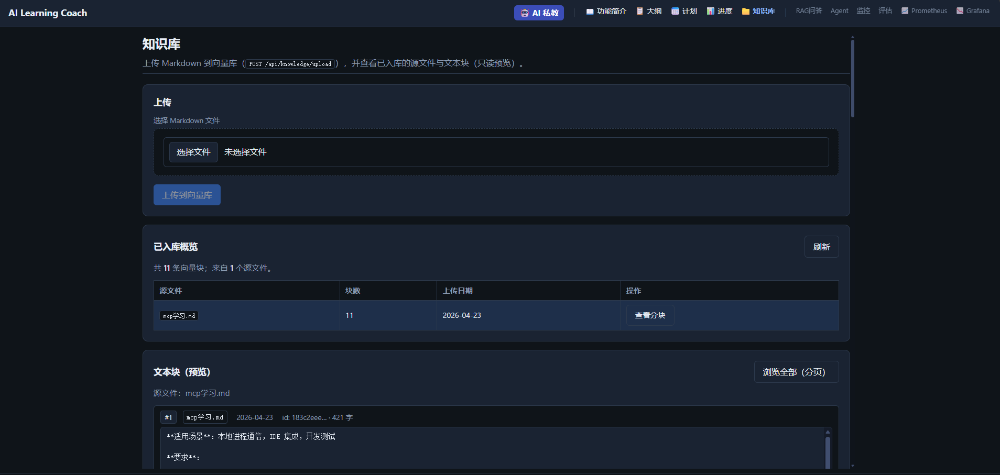
</p>

> 上传 `.md`，去重分块后写入 Chroma。

#### 图 6 · RAG 问答 · `/chat`

<p align="center">
  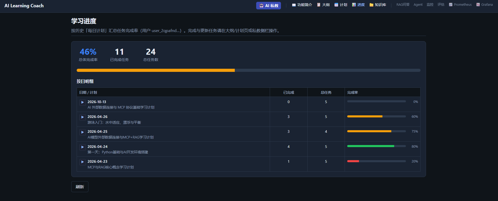
</p>

> 混合检索 + SSE 流式回答。

#### 图 7 · 学习大纲 · `/outline`

<p align="center">
  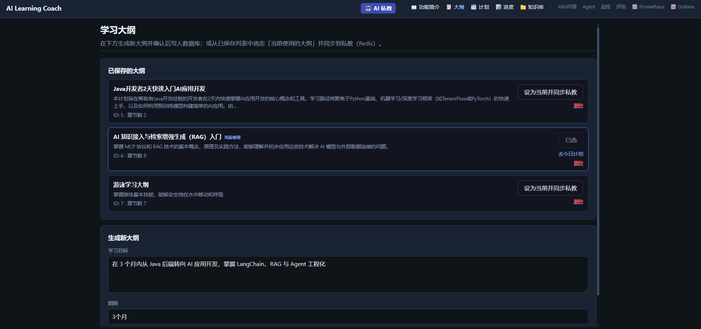
</p>

> 生成后用户 confirm，持久化至 PostgreSQL。

#### 图 8 · 每日计划 · `/plan`

<p align="center">
  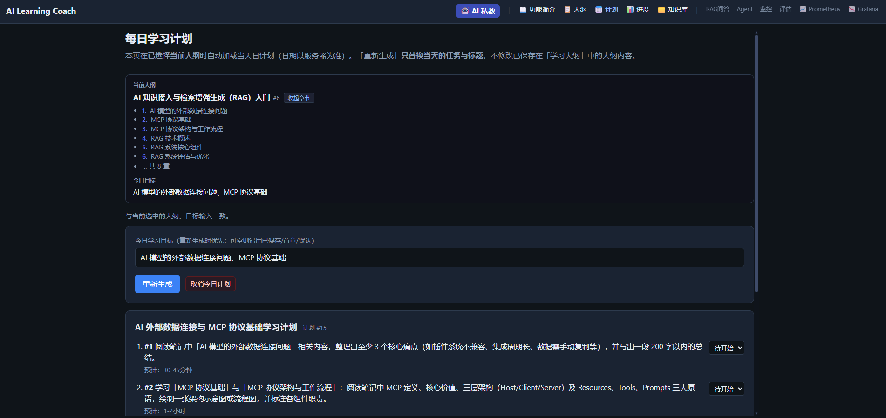
</p>

> LangGraph + MCP 生成今日任务。

<br/>

### 运维与质量

运行与抽检用的 **独立页面**（非对话主流程），从 Web 导航进入。

#### 图 9 · 应用监控 · `/metrics`

<p align="center">
  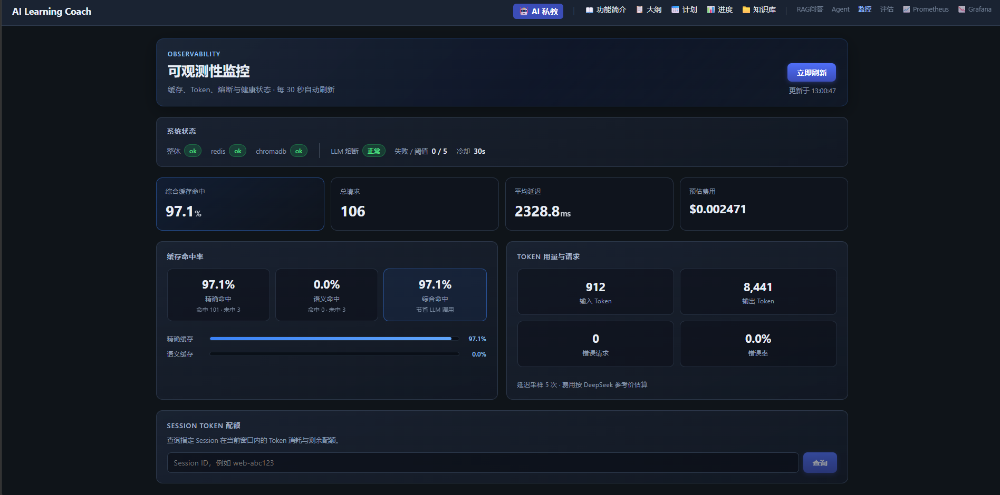
</p>

> 缓存命中、Token、熔断器、就绪探针、Session Token。

#### 图 10 · RAG 质量评估 · `/eval`

<p align="center">
  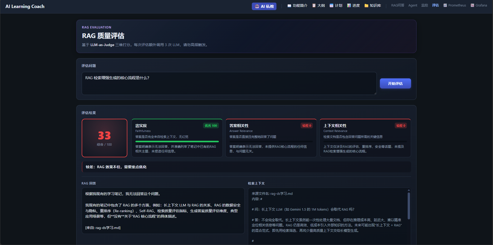
</p>

> LLM-as-Judge 三维评分（离线抽检，非在线高 QPS）。

#### 图 11 · Grafana · `/grafana`

<p align="center">
  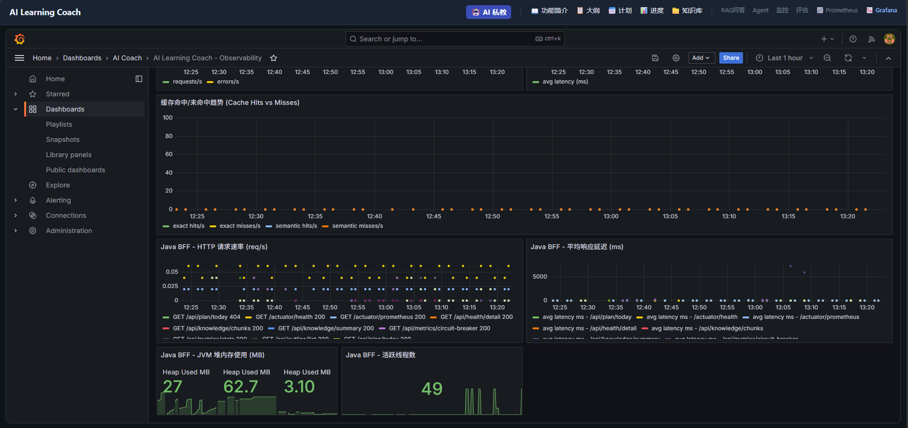
</p>

> 嵌入 Prometheus 预置盘（原生 UI：`/prometheus`）。

<br/>

### 工程与契约

集成与部署佐证，通常不在学习导航菜单中。

#### 图 12 · Swagger / 架构 / Compose 健康

<p align="center">
  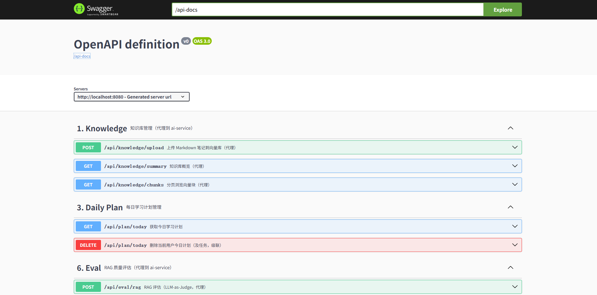
</p>

> [Swagger UI](http://localhost:8080/swagger-ui.html)、[`ARCHITECTURE.md`](docs/ARCHITECTURE.md) 截图，或 `docker compose ps` 全服务 `healthy`。

---

## 快速开始

### 1. 前置条件

| 项 | 说明 |
|----|------|
| Docker | [Docker Desktop](https://www.docker.com/products/docker-desktop/) + Compose v2 |
| 对话 | [DeepSeek](https://platform.deepseek.com/) API Key |
| 嵌入 | [硅基流动](https://siliconflow.cn/) 或其它 OpenAI 兼容接口（默认 `BAAI/bge-m3`） |
| 前端开发（可选） | Node.js 18 / 20 LTS → [`web/README.md`](web/README.md) |

### 2. 安装

```bash
cp .env.example .env
# 编辑 DEEPSEEK_API_KEY、SILICONFLOW_API_KEY
docker compose up --build -d
```

| 服务 | URL | 说明 |
|------|-----|------|
| Web | <http://localhost:3000> | Vue + Nginx → `/proxy-java` → BFF |
| Java BFF | <http://localhost:8080/swagger-ui.html> | **默认 API 入口** |
| AI Service | <http://localhost:8000/docs> | OpenAPI（联调 / 内网） |
| Chroma | <http://localhost:8001> | 向量库 |
| Prometheus | <http://localhost:9090> | 指标抓取 |
| Grafana | <http://localhost:3001> | 默认 `admin` / `admin123` |

Compose 对核心服务配置 **healthcheck** 与 `depends_on: service_healthy`，避免依赖未就绪时误调用。

> [!WARNING]
> 切勿提交含真实密钥的 `.env`。密钥若曾暴露，请在厂商控制台轮换。

> [!NOTE]
> 国内构建与代理：[`docs/docker/NETWORK.txt`](docs/docker/NETWORK.txt) · 分阶段自检：[`docs/docker/FULL-STACK-CHECKLIST.txt`](docs/docker/FULL-STACK-CHECKLIST.txt)

### 3. 验证

```bash
curl -s http://localhost:8000/health
curl -s http://localhost:8080/actuator/health
curl -s http://localhost:8080/api/metrics/stats | head -c 400
curl -s http://localhost:8000/api/metrics/circuit-breaker
```

```bash
docker exec aicoach_ai_service sh -c "cd /app && PYTHONPATH=/app python /app/scripts/e2e_network_check.py"
cd ai-service && python scripts/eval_smoke.py
```

### 4. 推荐体验

1. **知识库** 上传 `.md` → **RAG** 或 **私教** 提问  
2. **大纲** 确认入库 → **今日计划** → **进度**  
3. **指标** / **Grafana** 查看缓存与 Token  

### 5. 前端热开发

```bash
cd web && npm install && npm run dev
```

开发地址：<http://localhost:5173>（Vite 代理 Java `:8080`，与生产一致。）

### 6. 停止

```bash
docker compose down
docker compose down -v   # 删除 DB/监控卷，慎用
```

### 常见问题

| 现象 | 处理 |
|------|------|
| 容器内调不通 DeepSeek / Embedding | 检查 `.env` 中 `DOCKER_HTTP_PROXY`、Clash Allow LAN；运行 `e2e_network_check.py` |
| SSE 中断或空白 | 经 **:3000 / :8080** 访问；见 [`web/nginx.conf`](web/nginx.conf) |
| 构建 pip / npm 失败 | 见 NETWORK.txt；可覆盖 `PIP_INDEX_URL`、DaoCloud 基础镜像 |
| 服务长期 `starting` | `docker compose ps` 查看 health；可先单独启动 redis、chroma |

---

## 架构概览

### 逻辑拓扑

```
 Browser (:3000 或 Vite :5173)
       │  /proxy-java/api/*   （SSE: proxy_buffering off, read_timeout 300s）
       ▼
 Java :8080  ── Feign（JSON + 熔断） / WebClient（SSE） ──►  ai-service :8000
       ├── PostgreSQL   StudyOutline, DailyPlan, ChatHistory, …
       └── Redis        Spring Cache；与 Python 共用（会话 / 缓存 / 指标）

 ai-service ── Chroma ── DeepSeek + Embedding API
 Prometheus ◄── ai-service / java actuator / redis-exporter → Grafana
```

### 组件关系

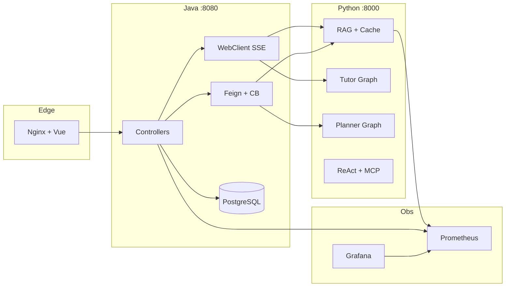

### 数据与路由

**PostgreSQL 实体（业务真相源）**

| 实体 | 用途 |
|------|------|
| `StudyOutline` / `StudyChapter` | 确认后的大纲结构 |
| `DailyPlan` / `Task` | 计划与任务 |
| `ChatHistory` | RAG 流结束后 **异步** 归档 |

**路由与 BFF**（完整列表见 [`web/src/router/index.ts`](web/src/router/index.ts)，客户端 [`web/src/lib/api.ts`](web/src/lib/api.ts)）

| 路径 | 主要 BFF |
|------|----------|
| `/`, `/chat` | `POST /api/tutor/chat`、`POST /api/chat`（SSE） |
| `/knowledge` | `/api/knowledge/*` |
| `/outline` | `/api/outline/*` |
| `/plan` | `GET /api/plan/today` |
| `/metrics`, `/eval` | `/api/metrics/*`、`POST /api/eval/rag` |

---

## 工程化设计

展开查看混合栈职责、存储分工与 **能力 → 源码** 映射。

<details>
<summary><b>点击展开：Java / Python 边界、存储、实现路径</b></summary>

#### Java vs Python

| Java BFF | Python ai-service |
|----------|-------------------|
| CRUD / 事务、大纲 confirm、进度 | 模型、RAG、Agent、Prompt、MCP |
| OpenFeign + `@CircuitBreaker` | FastAPI、SSE、LangGraph |
| Resilience4j、Spring Cache | Guardrails、Chroma 四 Collection |

#### 有状态存储

| 存储 | 用途 |
|------|------|
| Redis `chat:session:*` | 短期多轮记忆 |
| Redis + Chroma | 精确 / 语义问答缓存 |
| PostgreSQL | 大纲、计划、聊天历史 |
| Chroma `ai_learning_notes` | 向量知识库 |

#### 能力溯源

| 能力 | 源码 |
|------|------|
| 混合检索 + Rerank | `ai-service/app/rag/retriever.py`, `rerank.py` |
| 双层缓存 | `ai-service/app/cache/chat_cache.py` |
| Guardrails | `ai-service/app/guardrails/input_guard.py` |
| LLM 熔断 / 重试 | `ai-service/app/core/llm.py` |
| BFF 熔断 | `java-app/.../Resilience4jConfig.java`, `AiDailyPlanClient.java` |
| SSE + 异步落库 | `java-app/.../ChatService.java` |
| MCP 白名单 | `ai-service/app/tools/mcp_adapter.py` |
| RAG 评估 | `ai-service/app/evaluation/rag_evaluator.py` |

</details>

---

## 核心链路

RAG 摘要（逐步说明见 [`ARCHITECTURE.md` §4](docs/ARCHITECTURE.md#4-功能二rag-问答核心读取链路)）：

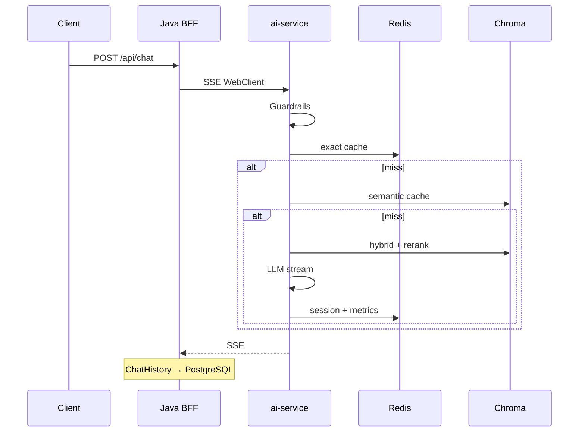

| 链路 | 要点 |
|------|------|
| 私教 | 意图分类 → `_INTENT_TOOLS` 并行工具 → 合成 → Redis 状态 |
| 每日计划 | LangGraph + MCP；Java 熔断 fallback 与业务异常分离 |

更多功能链路：[`docs/ARCHITECTURE.md`](docs/ARCHITECTURE.md) §3–§9。

---

## 可观测与运维

### Prometheus 抓取

配置：[`monitoring/prometheus.yml`](monitoring/prometheus.yml)

| Job | Target | 路径 |
|-----|--------|------|
| `aicoach_ai_service` | `ai-service:8000` | `/api/metrics/prometheus` |
| `aicoach_java_app` | `java-app:8080` | `/actuator/prometheus` |
| `redis` | `redis-exporter:9121` | Redis exporter |

### 应用侧

| 能力 | 入口 |
|------|------|
| 请求关联 | 响应头 `X-Request-ID` |
| 运维 JSON | BFF `GET /api/metrics/stats` |
| 熔断状态 | `GET /api/metrics/circuit-breaker` |
| 仪表盘 | [`monitoring/grafana/dashboards/aicoach.json`](monitoring/grafana/dashboards/aicoach.json) |

### 防护（摘要）

Guardrails、限流、API Key、Python + Java 双层熔断、MCP 域名白名单、Redis fail-open 与 `degraded` 健康 — 完整列表见 [`ARCHITECTURE.md` §13](docs/ARCHITECTURE.md#13-高可用防护层总结)。

---

## 配置

模板：[`.env.example`](.env.example)（Compose 注入 ai-service / java-app）。

| 类别 | 示例变量 |
|------|----------|
| 模型 | `DEEPSEEK_API_KEY`, `SILICONFLOW_API_KEY`, `EMBEDDING_MODEL_NAME` |
| Prompt | `PROMPT_QA_VERSION` |
| 安全 | `API_KEY_ENABLED`, `RATE_LIMIT_ENABLED`, `SESSION_TOKEN_BUDGET` |
| RAG | `RERANK_ENABLED`, `RETRIEVAL_CANDIDATES`, `SEMANTIC_CACHE_ENABLED` |
| 韧性 | `LLM_MAX_RETRIES`, `CIRCUIT_BREAKER_*`, `CHAT_STREAM_TIMEOUT` |
| 其它 | `LANGFUSE_*`, `MCP_WEB_ALLOW_DOMAINS` |

公网部署建议至少开启鉴权、限流与非零 Token 预算。默认值表：[`ARCHITECTURE.md` §11](docs/ARCHITECTURE.md#11-配置项速查表)。

---

## API 参考

| 层 | OpenAPI |
|----|---------|
| **BFF（前端默认）** | <http://localhost:8080/swagger-ui.html> |
| AI Service | <http://localhost:8000/docs> |

**ai-service 常用端点**

| 方法 | 路径 | 说明 |
|------|------|------|
| POST | `/api/knowledge/upload` | 知识库入库 |
| POST | `/api/chat`, `/api/tutor/chat` | RAG / 私教（SSE） |
| POST | `/api/chat/agent` | ReAct |
| POST | `/api/plan/daily` | 每日计划 |
| POST | `/api/eval/rag` | RAG 评估 |
| GET | `/api/metrics/stats`, `/api/metrics/prometheus` | 指标 |
| GET | `/api/metrics/circuit-breaker` | LLM 熔断 |
| GET | `/api/health/detail`, `/health` | 就绪 / 存活 |

BFF 代理上述能力并扩展大纲 confirm、进度等 — 以 Swagger 为准。

---

## 技术栈

| 层级 | 技术 |
|------|------|
| 前端 | Vue 3, Vite, TypeScript, Vue Router |
| BFF | Spring Boot 3, JPA, OpenFeign, WebClient, Resilience4j, Actuator + Micrometer |
| AI | FastAPI, LangChain, LangGraph, Pydantic, rank_bm25 |
| 数据 | PostgreSQL, Redis, ChromaDB |
| 工具 | MCP（stdio） |
| 观测 | Prometheus, Grafana, 可选 Langfuse |
| 交付 | Docker 多阶段构建, Compose, Nginx |

---

## 仓库结构

```
AI_Learning_Coach/
├── ai-service/       # FastAPI：RAG、Graph、MCP、metrics；scripts/ 冒烟与探活
├── java-app/         # BFF、JPA、Feign、WebClient、Resilience4j
├── web/              # Vue 3 + nginx.conf
├── monitoring/       # Prometheus、Grafana provisioning
├── docs/             # ARCHITECTURE.md、images/、docker 清单
└── docker-compose.yml
```

---

## 文档

| 文档 | 说明 |
|------|------|
| [**ARCHITECTURE.md**](docs/ARCHITECTURE.md) | 主架构：中间件、全链路、存储、配置、防护 |
| [IMPLEMENTATION_WALKTHROUGH.md](docs/IMPLEMENTATION_WALKTHROUGH.md) | 模块实现走读 |
| [FULL-STACK-CHECKLIST.txt](docs/docker/FULL-STACK-CHECKLIST.txt) | 部署自检 |
| [NETWORK.txt](docs/docker/NETWORK.txt) | 镜像加速与代理 |
| [web/README.md](web/README.md) | 前端开发 |

---

## 开发与贡献

1. **契约**：改 `ai-service/app/api` 时同步 `java-app` Controller / Feign。  
2. **AI**：`agents/`、`graphs/`、`prompts/`；新变量写入 `.env.example`。  
3. **前端**：仅经 BFF，不硬编码 `:8000`。  
4. **自检**：`eval_smoke.py`、Compose health、CHECKLIST 相关阶段。  

欢迎 Issue / PR。Monorepo 约定：[`.cursor/rules/project-overview.mdc`](.cursor/rules/project-overview.mdc)。

---

## 安全与许可

- **安全**：LLM 输出可能有误；公网部署请开启鉴权、限流、Token 预算，收紧 CORS 与 MCP 域名。  
- **许可**：[MIT License](LICENSE)

---

<div align="center">

**如果这个项目对你有帮助，欢迎 Star**

<https://github.com/stonebbmy/AI_Learning_Coach>

</div>
