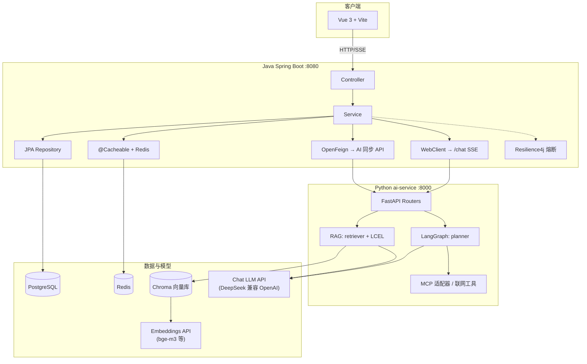
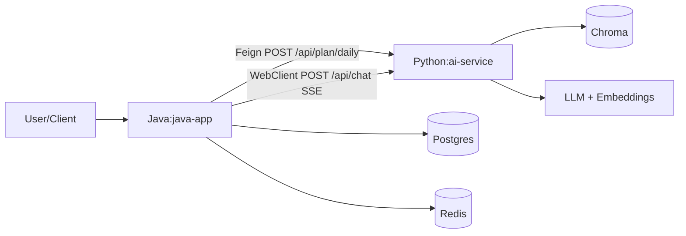

# AI Learning Coach｜项目实现与关键技术详解

> 版本 2.1：在 2.0 基础上补充 **工程化 RAG 迭代**（Prompt YAML、检索后重排、双级缓存、会话与长期记忆、可观测、工具 Agent 与多模态占位、前端与 Compose 调优），并增加 **[版本与迭代纪事](#0-版本与迭代纪事)** 体现项目**由粗到细**的演进。  
> 代码路径以仓库根目录 `AI_Learning_Coach` 为基准。

---

## 目录

1. [版本与迭代纪事](#0-版本与迭代纪事)
2. [项目架构全景图](#1-项目架构全景图)
3. [与 Spring Boot 分层的对应关系](#2-与-spring-boot-分层的对应关系)
4. [核心流程时序拆解](#3-核心流程时序拆解)
5. [技术栈深度解读（结合代码与 Java 生态对照）](#4-技术栈深度解读结合代码与-java-生态对照)
6. [核心技术问答（10 道）](#5-核心技术问答10-道)
7. [改进与进阶方向](#6-改进与进阶方向)
8. [关键技术细粒度实现](#7-关键技术细粒度实现)
  - [7.1 RAG：从上传到问答](#71-rag从上传到问答)
  - [7.2 在线检索与混合检索与重排](#72-在线检索与混合检索与重排)
  - [7.3 LCEL 问答链与流式输出（含 YAML Prompt）](#73-lcel-问答链与流式输出含-yaml-prompt)
  - [7.4 Java BFF 与前端 SSE](#74-java-bff-与前端-sse)
  - [7.5 LangGraph 每日计划](#75-langgraph-每日计划)
  - [7.6 大纲生成与 PydanticOutputParser](#76-大纲生成与-pydanticoutputparser)
  - [7.7 MCP 适配](#77-mcp-适配)
  - [7.8 缓存、会话记忆与可观测（Python + Redis + Chroma）](#78-缓存会话记忆与可观测python--redis--chroma)
  - [7.9 工具 Agent 与多模态占位](#79-工具-agent-与多模态占位)
  - [7.10 前端与本地开发 Compose 注意点](#710-前端与本地开发-compose-注意点)
  - [7.11 粒度自查表](#711-粒度自查表)

---

## 0. 版本与迭代纪事

本仓库**不是一次性写成最终形态**，而是按「能跑通 → 能演示 → 能讲工程化」逐步加厚。下表与后文各节一一对应，便于理解各阶段的**演进动机**。


| 阶段              | 时间线（概略）  | 主要目标                                                     | 代表能力                                                                                                                                                            |
| --------------- | -------- | -------------------------------------------------------- | --------------------------------------------------------------------------------------------------------------------------------------------------------------- |
| **MVP**         | 初版       | 打通 Vue ↔ Java ↔ Python、RAG、大纲、知识上传、LangGraph 计划、MCP 联网雏形 | 混合检索、LCEL 问答、SSE 经 Java 转发、Feign 调 `/plan/daily`、Chroma + Docker                                                                                                |
| **工程化 RAG 迭代**  | 2.0 文档之后 | 对齐常见工程化实践：可版本 Prompt、两阶段检索、缓存降本、多轮、可观测                  | YAML Prompt（`PROMPT_QA_VERSION`）、`rerank`、Redis 精确缓存 + Chroma 语义缓存、Redis 短期记忆、可选长期记忆、结构化日志、可选 Langfuse                                                          |
| **Agent 与前端补全** | 同上       | 与「固定 RAG 链」并列展示 Tool-use，前端可点                            | `POST /api/chat/agent`（Python + `create_react_agent`）、Java `AiServiceClient.chatAgent` + `ChatController`；`AgentChatView`；`ChatView` 多轮 transcript + `messages` |


**设计取舍（刻意保留的「对比材料」）**：

- **流式 RAG** 走 **WebClient**；**非流式**工具 Agent 走 **OpenFeign**，同一份《为何 Feign 不适合 SSE》的叙事。  
- `**@Cacheable` 仅按日期**（`PlanService`）仍保留在代码中，文档 5.9/6.1 小节强调其风险——既可讲清楚缓存语义，也保留「可改为含 `goal` 的 key」的改进点。  
- **多模态**仅 `/api/chat/vision-probe` 占位，避免未接视觉模型时产生费用。

---

## 1. 项目架构全景图

### 1.1 分层与组件交互

项目采用 **「Java 业务编排 + Python AI 编排」** 混合架构：Vue 前端主要对接 **Java（:8080）**；**Python FastAPI（:8000）** 承载 LLM、RAG、LangGraph；**PostgreSQL** 存业务实体；**Redis** 既做 Java `@Cacheable` 的**当日计划缓存**，也做 **ai-service** 侧会话与**精确命中缓存**（与 Chroma**语义缓存**配合降本）；**Chroma** 多 collection（笔记主库、语义缓存、可选长期记忆）；对话 LLM 与 Embedding 可走不同供应商（如 DeepSeek + 硅基流动 bge-m3）。




**数据面要点**：业务强一致在 Java + Postgres；语义检索与笔记摄取在 Python + Chroma；**流式对话**不经 Feign（同步客户端不适合 SSE），而用 **WebClient + `Flux`** 透传。

### 1.2 调用拓扑（简图）




### 1.3 为什么这样拆分

- **Java 侧**：企业级工程化（鉴权、限流、事务、缓存、熔断、可观测性）与领域模型更成熟。
- **Python 侧**：LangChain / LangGraph / MCP 等生态迭代快，适合 Prompt、RAG、Agent 编排。
- **价值**：用 Java 做稳态业务，用 Python 做快速演进的智能层，**HTTP 契约**清晰即可协作。

---

## 2. 与 Spring Boot 分层的对应关系


| Spring 经典分层          | 本项目中对应                                                             | 职责差异                                                            |
| -------------------- | ------------------------------------------------------------------ | --------------------------------------------------------------- |
| **Controller**       | Java `ChatController` / `PlanController`；Python `APIRouter`        | Java：对外契约、媒体类型、校验。Python：偏 **AI 能力端点**，常直接绑定 Runnable 链或 Graph。 |
| **Service**          | Java `PlanService`、`ChatService`；逻辑在 `agents/`、`chains/`、`graphs/` | 传统 Service 是领域规则 + 事务；AI 侧大量是 **Prompt 组装、检索、多步状态机**，更像编排引擎。    |
| **DAO / Repository** | Java JPA `*Repository`；向量侧无 JDBC，用 LangChain `Chroma`              | 表行映射 vs **embedding + 相似度 + metadata** 的「语义 Top-K」。             |
| **（无直接同名）**          | `app/core/llm.py`、`retriever.py`、`planner_graph.py`                | 类似基础设施 + 模型网关 + 检索策略 + 工作流；在 Java 里常拆成防腐层与多个 Adapter。           |


---

## 3. 核心流程时序拆解

### 3.1 RAG 流式问答（端到端，含迭代后能力）

**路径**：`web/src/views/ChatView.vue`（可选多轮 `messages` + `sessionId`）→ `web/src/lib/api.ts` `streamChat` → `POST /api/chat`（Java）→ `POST /api/chat`（Python，SSE）→（**缓存未命中时**）混合检索 →（**可选**）重排 → YAML Prompt（含 `history_block`）→ LLM 流式 → SSE 回传；流结束后可写 **Redis 会话/精确缓存**、**Chroma 语义缓存**、**可选长期记忆**。

1. **前端**：对 Java 发起 `Accept: text/event-stream`，`ReadableStream` 按行解析 `data:`；`ChatView` 可维护 transcript 并随请求传 `messages`，也可仅依赖后端按 `session_id` 用 Redis 存近期多轮。
2. **Java**：`ChatController` 返回 `Flux<String>`；`ChatService` 用 **WebClient** `bodyToFlux(String.class)` 订阅 Python 的 SSE 原始字符串流。`ChatRequest` 可带 `messages`（`ChatMessageDto` 列表）转发给 Python。
3. **Python 入口**（`app/api/chat.py`）：合并 **客户端 `messages`** 与 **Redis 短期记忆**（`load_session_messages`）为 `history_block`；`LONG_MEMORY_ENABLED=true` 时可合并 **长期记忆**（`retrieve_long_memory_context`）。**精确缓存**（Redis）与**语义缓存**（Chroma 独立 collection）命中则直接 SSE 返回。未命中则 `get_qa_chain().astream(payload, config=callbacks)`，其中 `payload` 含 `question` 与 `history_block`；**可选 Langfuse** `callbacks`；每块 `yield {"data": chunk}`，`event: end` / `event: error` 同前。
4. **RAG 链**（`app/agents/qa.py`）：`RunnableLambda` 归一化输入 → `RunnablePassthrough.assign(context=_retrieve_and_format)` → `**build_qa_chat_template()`**（YAML：`app/prompts/versions/qa_{v1|v2}.yaml`，`PROMPT_QA_VERSION`）→ `llm` → `StrOutputParser`。**模板变量**：`context`、`question`、`history_block`（`app/prompts/templates.py` 中旧 `QA_PROMPT_TEMPLATE` 仍保留作对照，**主路径以 YAML 为准**）。
5. **混合检索 + 重排**（`retriever.py` + `rerank.py`）：`get_retriever_from_store()` 可增大单路 `k`（`RETRIEVAL_CANDIDATES`），候选用 **同一套 Embedding 余弦精排**（`RERANK_ENABLED`）至 `RERANK_TOP_N`，再 `_format_docs`；`EnsembleRetriever` 权重仍为 **向量:BM25 = 7:3**（`weights=[0.3, 0.7]` 与两 retriever 顺序一致）。
6. **大模型**：`app/core/llm.py` 中 `ChatOpenAI` 指向 DeepSeek，`streaming=True` 以支持 `astream`。

**LLM 调用点**：LCEL 链中的 `| llm|`。**RAG 检索点**：`_retrieve_and_format`（在 `llm` 之前）。**说明**：`PlanService` 上 `@Cacheable` 与聊天侧缓存不同；前者导致「断点进不了 `getTodayPlan`」多因**缓存命中**（见 5.9、7.11 表）。

### 3.2 每日学习计划（LangGraph + 工具）

**以当前代码为准**（`app/api/plan.py` + `app/graphs/planner_graph.py`；**不是**旧版仅 `AgentExecutor` 直调）。

1. `POST /api/plan/daily`，body 含 `goal`。
2. **LangGraph**：`analyze_goal` → `retrieve_notes`（`search_my_notes.invoke`）→ `web_research`（MCP 辅助）→ `draft_plan`（`llm.ainvoke` 出 JSON 字符串）→ `validate_plan`（`json.loads` + Pydantic）→ 失败则 `repair_plan` 再校验。
3. **Java**：`PlanService` 上 `@Cacheable` + 按日期查库 → 无则 **OpenFeign** 调 Python → 落库；失败 **Resilience4j** fallback。

**LLM 调用点**：`_draft_plan`、`_repair_plan`。**笔记侧 RAG**：`search_my_notes` 内部使用 `get_retriever_from_store()`，与问答链同思路。

### 3.3 知识上传（摄取流水线）

`POST /api/knowledge/upload`：`.md` → 临时落盘 → `load_markdown_file`（`TextLoader`）→ 补 `metadata` → `RecursiveCharacterTextSplitter` → `add_documents_to_store` 写入 Chroma。属 **Indexing**，与在线 **Retrieval** 分离。

### 3.4 学习大纲

- 生成：`POST /api/outline/generate`（Python，LCEL + PydanticOutputParser）。
- 确认入库：`POST /api/outline/confirm`（Java，Postgres）。前端在 `web/src/lib/api.ts` 中**生成走 Python、确认走 Java**。

---

## 4. 技术栈深度解读（结合代码与 Java 生态对照）

### 4.1 后端与网关

- **FastAPI**：异步路由、生命周期 `lifespan` 预热 `get_vector_store()`。类比 Spring 启动时预热 Bean。
- **OpenFeign**：`AiServiceClient` 声明式调用 `POST /plan/daily` 与 `POST /chat/agent`（非流式 JSON）。**注意**：`AiServiceClient` 注释写明 **SSE 不适合 Feign**，**流式**聊天用 **WebClient**（`ChatService.streamChat`）。
- **WebClient + Reactor**：`ChatService.streamChat` 返回 `Flux<String>` 透传 SSE。对比：**RestTemplate** 不适合长连接流式；类似用 **aiohttp 读 stream** 的语义。

### 4.2 LangChain

- **LCEL**：`prompt | llm | parser` 或带 map 的字典分支，用 `|` 组合 Runnable。类比 Stream/Reactor 管道，但语义是 RAG/Agent 步骤。
- **Retriever**：`EnsembleRetriever`、`Chroma.as_retriever`、BM25 在内存的 `from_documents`。
- **链式 RAG**：见 `app/agents/qa.py`。

### 4.3 LangGraph

- 显式 **StateGraph**、节点、条件边；每日计划在 `planner_graph.py` 中实现 **校验-修复回路**（`validate_plan` / `repair_plan`）。

### 4.4 向量与嵌入

- **Chroma**：`vector_store.py` 支持 `remote`（`HttpClient`）与 `embedded`（`PersistentClient`），与 `docker-compose.yml` 中 `chroma` 服务及环境变量 `CHROMA_*` 对齐。
- **Embedding**：`OpenAIEmbeddings` 独立 base_url/key，与 chat 的 DeepSeek 可分离（`app/core/llm.py`、`app/core/config.py`）。

### 4.5 前端

- Vite 开发代理：Java / AI 基址在 `web/src/lib/api.ts`；聊天经 **Java** `POST /api/chat` 转发 Python。

### 4.6 跨服务字段

- Java `ChatRequest` 使用 `@JsonProperty("session_id")` 等，与 Python Pydantic `ChatRequest` 的 `session_id` 对齐（`java-app/.../dto/ChatRequest.java`）。

---

## 5. 核心技术问答（10 道）

每题：**关注点** + **回答要点**。

1. **RAG 基本流程？本项目检索与生成分别在何处？**
  - 意图：是否理解「先检索后生成」。  
  - 要点：Indexing（upload 切分写入 Chroma）与推理（`get_qa_chain` 中 retriever → prompt → llm）；`qa.py`、 `knowledge.py`。
2. **混合检索（BM25 + 向量）解决什么？权重含义？**
  - 意图：关键词 vs 语义。  
  - 要点：专有名词/精确词 BM25；同义改写用向量；`weights` 与 `retrievers` 顺序一一对应。
3. **全量拉取 Chroma 再建 BM25 为何在规模化时危险？**
  - 意图：工程与复杂度。  
  - 要点：O(N) 内存与延迟；可离线索引、分片、向量+rerank、或 ES 混合等。
4. **SSE 相对一次 JSON 的优势与坑？**
  - 意图：体验与运维。  
  - 要点：首 token 延迟、网关/超时、断线；Java 需 WebClient/超时/背压配置。
5. **为何计划用 Feign、聊天用 WebClient？**
  - 意图：客户端选型。  
  - 要点：Feign 适合请求-响应 JSON；SSE 是长流，要响应式或流式 API。
6. **LangGraph 相对单 Prompt 或纯 AgentExecutor 的价值？**
  - 意图：可维护性。  
  - 要点：显式状态、校验/修复边、可插桩日志与重试（`planner_graph.py`）。
7. **如何保证计划输出是可解析的 JSON？**
  - 意图：鲁棒性。  
  - 要点：强约束 prompt；`json.loads` + Pydantic；`repair_plan`；生产可再加「提取子串」兜底。
8. **Chat 与 Embedding 模型分开展示的原因？**
  - 意图：成本与能力。  
  - 要点：部分 LLM 无稳定 embedding；专用向量模型；密钥与 base_url 分治。
9. **缓存：`@Cacheable` 仅按日期 key 可能出什么问题？**
  - 意图：缓存一致性。  
  - 要点：不同 `goal` 复用同 key 会串数据；应把 `goal` 或 hash 纳入 key 或调整策略。
10. **生产可观测性你会加什么？**
  - 意图：SRE。  
    - 要点：`x-request-id` 贯通（Python middleware）、Java 日志 MDC、LLM 延迟/token、检索命中率、熔断与工具调用审计。

---

## 6. 改进与进阶方向

### 6.1 瓶颈与隐患

- **BM25 全量重建**：`retriever.py` 从 Chroma 取全文档再建 BM25，数据量大时慢、占内存。
- **计划缓存 key**：`PlanService` 若仅按日期，不同 `goal` 可能互相覆盖（应纳入 `goal` 或改策略）。
- **流式聊天落库**：`saveChatHistory` 需客户端二次提交，易丢完整会话，需产品化约定。
- **密钥与日志**：避免在日志中打印含敏感信息的请求体；compose 用 `.env` / secrets。
- **LangGraph 边界**：`repair_count >= 2` 时仍可能走 `END`，需结合业务确认是否应统一返回 5xx 或空计划。

### 6.2 三个可落地迭代（与当前代码对照）

1. **Agent/工具层**：`planner_graph` 与 `mcp_adapter` 已可跑通；可继续加「条件边：仅当需要时再 `web_research`」、替换 DuckDuckGo 为带 Key 的搜索 API。另：独立 `**POST /api/chat/agent`（`langgraph.prebuilt.create_react_agent`）** 已作为与固定 RAG 链并列的演示入口（见 7.9）。
2. **缓存层**：Python 侧已加 **Redis 精确缓存 + Chroma 语义缓存**、Java 侧仍保留按日期的 `@Cacheable`；**仍建议**将 `PlanService` 的 key **纳入 `goal` 或 hash**，避免不同目标串单（见 5.9）。
3. **多模态/附件**：`POST /api/chat/vision-probe` 为占位；扩展时需接视觉模型并设 `MULTIMODAL_ENABLED`；`knowledge` 仍可扩展 loader 与分块类型。

### 6.3 与旧文档的差异（以代码为准）

- **每日计划**：当前为 **LangGraph**（`plan.py` 调 `get_planner_graph`），`planner.py` 的 `AgentExecutor` 为保留/可复用模块，**主路径以 Graph 为准**。
- **知识加载**：`loader.py` 使用 **LangChain `TextLoader`**（UTF-8），非 Unstructured 全家桶。

---

## 7. 关键技术细粒度实现

本章节把「从函数到数据形状」说透，便于断点调试与对照源码逐项理解。

### 7.1 RAG：从上传到问答

#### 7.1.1 离线摄取 `POST /api/knowledge/upload`


| 步骤    | 位置                        | 行为                                                                                      |
| ----- | ------------------------- | --------------------------------------------------------------------------------------- |
| 校验与落盘 | `app/api/knowledge.py`    | 仅 `.md`，写入 `data/`，再读入处理                                                                |
| 加载    | `app/rag/loader.py`       | `TextLoader` → `List[Document]`                                                         |
| 元数据   | 同上                        | `source`=文件名，`upload_date`=当天，供检索侧展示「来源」                                                |
| 切分    | `app/rag/splitter.py`     | `RecursiveCharacterTextSplitter`，`CHUNK_SIZE`/`CHUNK_OVERLAP`（如 500/50），分隔含 `\n\n`、中文标点 |
| 入向量库  | `app/rag/vector_store.py` | `add_documents` → 调用 `OpenAIEmbeddings` 写入 Chroma collection                            |


`**Document**`：LangChain 中一段「正文 + metadata」，**不是** JDBC 行，是 RAG 流水线中间表示。

**分割器要点**：`RecursiveCharacterTextSplitter` 按 `separators` 从大到小尝试切分，减少切断句子；`chunk_overlap` 让相邻块重叠，降低边界切掉关键句的概率。

**Chroma 拓扑**：`CHROMA_MODE=remote` 时 `HttpClient` 连 Docker 内 `chroma:8000`，多实例时避免各进程各用 embedded SQLite 各写各的导致不一致。

#### 7.1.2 在线流 `POST /api/chat`（与缓存/记忆/观测）

- 路由：`app/api/chat.py` → 合并 `history_block`、可选 **缓存短路** → `get_qa_chain()` → `qa_chain.astream(payload)` → `EventSourceResponse`（sse-starlette）。
- 每块 `yield {"data": chunk}`；结束 `event: end`；异常 `event: error`；`app/observability/tracing.py` 中 `structured_log("chat_complete", ...)` 记录大致耗时与 token 估算；配置 `LANGFUSE_*` 时注入 **Langfuse** `callbacks`。
- 流结束：`append_session_message`（Redis）、`set_exact_cached_answer`、`**add_semantic_cache_entry`**（Chroma 语义相似缓存）、`index_qa_turn`（`**LONG_MEMORY_ENABLED` 时** 长期记忆入库）。

---

### 7.2 在线检索与混合检索与重排

`**get_retriever_from_store(*, candidate_k=...)`**（`app/rag/retriever.py`）：

1. `get_chroma_collection` 之 **笔记主 collection**（`CHROMA_COLLECTION_NAME`）。
2. `vector_store.get(...)` 拉**当前 collection 全量** `documents` + `metadatas`（为 BM25 建索引）。
3. 空则 `_EmptyRetriever()`。
4. 重建为 `Document` 列表 → `BM25Retriever.from_documents`，`k` 默认随 `**RETRIEVAL_CANDIDATES`** 增大单路召回（可大于旧版固定 3）。
5. `vector_store.as_retriever(search_kwargs={"k": 同上})`。
6. `EnsembleRetriever(retrievers=[bm25, vector], weights=[0.3, 0.7])`：**BM25:向量 = 3:7**。

**检索后重排**（`app/rag/rerank.py`）：`rerank_documents_by_embedding` 用 **同一套** `OpenAIEmbeddings` 对候选项与 query 做余弦精排，取 `RERANK_TOP_N`；`RERANK_ENABLED` 为 false 时可只截断长度。

`**search_my_notes` 工具**（`app/tools/local_tools.py`）：`get_retriever_from_store().invoke(query)`，供 LangGraph/Agent 用；**问答链**在 `_retrieve_and_format` 中走「**宽召回 + 重排**」。

---

### 7.3 LCEL 问答链与流式输出（含 YAML Prompt）

**数据流**（`app/agents/qa.py` + `app/prompts/yaml_loader.py` + `app/prompts/versions/qa_*.yaml`；`app/prompts/templates.py` 保留大纲/计划与**旧 RAG 常量的对照**）：

```text
输入: str 或 { question, history_block }
        │
        ├─ RunnableLambda(_normalize_input) ──► { question, history_block }
        ├─ assign(context = _retrieve_and_format(question))  // 含混合检索 + rerank + _format_docs
        ▼
  build_qa_chat_template()   // YAML：context, question, history_block
        ▼
  llm  →  StrOutputParser()
```

`**PROMPT_QA_VERSION**`：选 `v1` / `v2` 对应不同 YAML 文件。`format_history_block` 将多轮对话注入 System 侧；**主路径不再依赖** `QA_PROMPT_TEMPLATE` 常量产线。

`**_format_docs`、流式 `astream`**：与 2.0 描述一致；输入由「仅 question」扩展为**字典**以支持 `history_block`。

---

### 7.4 Java BFF 与前端 SSE

- `**ChatService`**（`java-app/.../ChatService.java`）：`WebClient` `POST` 到 AI 的 `/chat`（**baseUrl 常已含 `/api`，uri 为 `/chat`** 以与 FastAPI 路由一致，以运行环境为准）、`accept(TEXT_EVENT_STREAM)`、`bodyToFlux(String.class)` —— 透传 **SSE 原始分片**。
- `**ChatRequest`**：`question`、`session_id` 与**可选** `List<ChatMessageDto> messages` 序列化后，与 Python `ChatRequest.messages` 对齐。
- `**ChatController`**：除 `POST` 产 `text/event-stream` 外，另有 `**POST /api/chat/agent**` 返回 JSON，内部 `**AiServiceClient.chatAgent**`（OpenFeign）。
- **前端** `web/src/lib/api.ts` `streamChat`：可选传 `messages`；`chatAgent` 专供非流式 Agent 页。

**为何不用 RestTemplate 一次读 body**：SSE 是长连接、多块；需 **Reactor/流式** 或底层流读取。

---

### 7.5 LangGraph 每日计划

**入口**：`app/api/plan.py` → `await get_planner_graph().ainvoke({"goal": request.goal})`。

**状态** `PlannerState`：在节点间传 `goal`、`notes_context`、`web_context`、`plan_raw`、`plan`、`validation_error`、`repair_count` 等。

**固定边**：`analyze_goal` → `retrieve_notes` → `web_research` → `draft_plan` → `validate_plan`。

**条件边**（`validate_plan` 之后）：

- 无 `validation_error` → `END`；
- 有错且 `repair_count < 2` → `repair_plan` → 再回到 `validate_plan`；
- `repair_count >= 2` 时仍可能走到 `ok` 结束，属**需在生产收紧**的边界。

`**draft` / `repair`**：用 `llm.ainvoke`；校验用 `json.loads` + `DailyPlanResponse`（Pydantic）。

**与 `planner.py` 的 `AgentExecutor`**：可并存；**当前 HTTP 路径以 Graph 为准**。

---

### 7.6 大纲生成与 PydanticOutputParser

**链**（`app/chains/outline_chain.py`）：`prompt | llm | parser`，`PydanticOutputParser(pydantic_object=StudyOutlineResponse)`。

**注意**：`outline_chain.py` 对含 JSON 的 system 文本做 `replace("{", "{{")` 再包进 `ChatPromptTemplate`，避免与 **模板变量 `{target}` 等** 冲突 —— LangChain 模板常见坑。

**调用**：`await chain.ainvoke({target, deadline})`，得到 **Pydantic 对象**，FastAPI 直接 `response_model` 输出 JSON。

---

### 7.7 MCP 适配

`**web_research(query)`**（`app/tools/mcp_adapter.py`）：

- `_call_mcp_tool` 通过 `StdioServerParameters` 启动子进程 `python -m app.mcp_servers.web_research_server`，**ClientSession** 调 `web_search` / 可选 `web_fetch`；**每次调用新建会话**（可后续池化）。
- 域名白名单 `_is_allowed_url`；结果拼成紧凑上下文字符串给 Graph 的 `web_context`。

`**get_mcp_tools()`**：把能力封装为 LangChain `Tool`，给传统 Agent 用；**LangGraph 侧当前可直接 `await web_research(goal)`**，不经过 ReAct 工具循环。

`**app/mcp_servers/web_research_server.py**`：`web_search` 为 DuckDuckGo HTML 抓取，**无 API Key**，依赖容器/运行环境**出网**与页面结构；失败时 `web_context` 可能为空，图仍走 `draft_plan`。

---

### 7.8 缓存、会话记忆与可观测（Python + Redis + Chroma）


| 机制           | 位置                                                   | 行为                                                                                                  |
| ------------ | ---------------------------------------------------- | --------------------------------------------------------------------------------------------------- |
| **精确命中缓存**   | `app/cache/chat_cache.py`                            | Redis key：`cache:chat:exact:{sha256(归一化问题)}`；命中则 `/api/chat` 直接 SSE 返回答案，不跑 RAG                     |
| **语义相似缓存**   | 同上 + `get_semantic_cache_store()`                    | 独立 Chroma collection（`SEMANTIC_CACHE_COLLECTION`），与笔记库隔离；近邻距离低于 `SEMANTIC_CACHE_MAX_DISTANCE` 则命中   |
| **短期多轮**     | `app/memory/conversation.py`                         | `chat:session:{session_id}` 列表，TTL；**优先**用请求体 `messages`，否则用 Redis                                  |
| **长期记忆（可选）** | `app/memory/long_term.py`                            | `LONG_MEMORY_ENABLED=true` 时向 `SESSION_MEMORY_COLLECTION` 写入/检索，带 `session_id` 元数据                  |
| **可观测**      | `app/observability/tracing.py` + `app/core/trace.py` | 结构化 `structured_log`；**Langfuse** 在配置 `LANGFUSE_PUBLIC_KEY/SECRET_KEY` 时作为 LangChain `callbacks` 注入 |
| **Redis 连接** | `app/cache/redis_client.py`                          | 连接失败时 `_redis_failed` 置位，**静默降级**无缓存/无会话，避免拖垮主链路                                                    |


`**vector_store.py` 多 collection**：`get_chroma_collection(name)` 单例多集合，除笔记外含语义缓存、长期记忆等。

---

### 7.9 工具 Agent 与多模态占位


| 能力              | 路径                                                                    | 说明                                                                                                                               |
| --------------- | --------------------------------------------------------------------- | -------------------------------------------------------------------------------------------------------------------------------- |
| **非流式工具 Agent** | Python `app/api/chat_agent.py` + `app/agents/react_agent.py`          | `langgraph.prebuilt.create_react_agent(llm, tools)`，工具含 `get_current_time`、`search_my_notes`；**JSON** 返回 `answer` / `request_id` |
| **Java 转发**     | `AiServiceClient.chatAgent` + `ChatController` `POST /api/chat/agent` | 与流式 `WebClient` 分工明确（Feign = 请求-响应）                                                                                              |
| **多模态**         | `app/api/multimodal.py` `POST /chat/vision-probe`                     | 默认 **503/501**，`MULTIMODAL_ENABLED` 与视觉模型接好后再实现                                                                                  |


---

### 7.10 前端与本地开发 Compose 注意点

- **RAG 页** `web/src/views/ChatView.vue`：多轮 **transcript**、可选 `messages` 与「清空会话」；**工具 Agent 页** `web/src/views/AgentChatView.vue`：调 `chatAgent()`；路由 `/agent`；`App.vue` 导航已链入。
- `**web/src/lib/api.ts`**：`chatAgent`、`visionProbe`；`streamChat` 第五参 `messages`。
- `**docker-compose.yml**`：ai-service 环境变量含 `**REDIS_HOST=redis**`、`PROMPT_QA_VERSION` 等。
- `**docker-compose.override.yml**`：本地**代码挂载**与 `debugpy` 监听 5678；**勿**对生产使用 `--wait-for-client`，否则 **8000 不监听**；`healthcheck` 应对 `/health` 发真实探活，勿用 `echo` 假健康。

---

### 7.11 粒度自查表


| 技术点               | 应能口述的完整流程                                                                                                                                             |
| ----------------- | ----------------------------------------------------------------------------------------------------------------------------------------------------- |
| 上传 → 可检索          | TextLoader → metadata → RecursiveCharacterTextSplitter → Chroma.add_documents（Embedding API）                                                          |
| 问一句答一句            | **缓存未命中** → 混合检索 → **embedding rerank**（可选）→ `_format_docs` → **YAML** ChatPrompt（含 `history_block`）→ DeepSeek 流式 → SSE → WebClient Flux → 前端 `data:` |
| LCEL 输入           | `normalize` + `assign(context=...)`，模板变量 **context / question / history_block**                                                                       |
| Ensemble + rerank | 两路先宽召回，再**同一 embedding 精排** Top-N                                                                                                                     |
| LangGraph 计划      | 笔记 + MCP 联网（可空）→ JSON 草稿 → Pydantic 校验 → 修复环                                                                                                          |
| `@Cacheable` 与断点  | **缓存命中**则不进入 `getTodayPlan` 方法体，Feign 与 DB 逻辑不执行；调试可清 Redis 或关缓存                                                                                      |
| 跨语言               | Java `JsonProperty`/`JsonAlias` 与 Pydantic 字段对齐；`ChatRequest` 可带 `messages`                                                                           |


---

## 附录：主要代码路径速查


| 能力            | 路径                                                      |
| ------------- | ------------------------------------------------------- |
| FastAPI 入口与路由 | `ai-service/main.py`                                    |
| 聊天 SSE        | `ai-service/app/api/chat.py`                            |
| RAG 链         | `ai-service/app/agents/qa.py`                           |
| 混合检索          | `ai-service/app/rag/retriever.py`                       |
| 向量库           | `ai-service/app/rag/vector_store.py`                    |
| 知识上传          | `ai-service/app/api/knowledge.py`                       |
| 每日计划图         | `ai-service/app/graphs/planner_graph.py`                |
| 计划 API        | `ai-service/app/api/plan.py`                            |
| 大纲链           | `ai-service/app/chains/outline_chain.py`                |
| LLM/Embedding | `ai-service/app/core/llm.py`                            |
| 配置            | `ai-service/app/core/config.py`                         |
| Java 流式       | `java-app/.../ChatService.java`                         |
| Java 计划+Feign | `java-app/.../PlanService.java`, `AiServiceClient.java` |
| 前端聊天          | `web/src/lib/api.ts`, `web/src/views/ChatView.vue`      |
| 编排与基础设施       | `docker-compose.yml`                                    |


---

*文档完。*